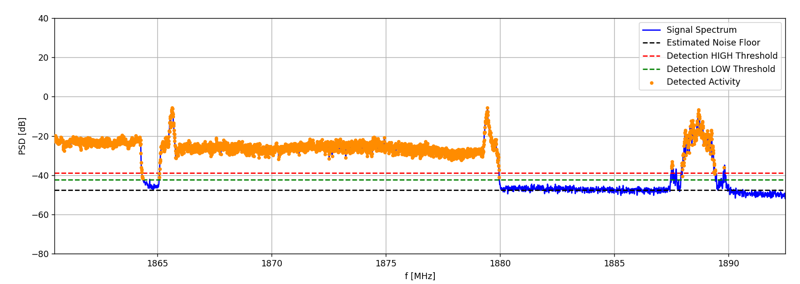

# SDR Wideband Monitor

Python-based SDR system for wideband radio spectrum monitoring using ADALM-Pluto.

The project is being developed as part of a master's thesis:

**Wideband radio transmission monitoring and classification using SDR technology**

The main goal is to monitor a wide frequency range, automatically scan selected bands, detect radio activity, analyze received signals, and eventually classify detected transmissions.

## Current features

- ADALM-Pluto IQ acquisition
- Configurable SDR and spectrum presets
- Welch PSD estimation
- Live spectrum visualization
- Processing bandwidth / edge masking
- MAX HOLD spectrum
- Noise floor estimation
- Radio activity detection

    

## Planned features

- Burst tracking
- Automatic frequency scanning
- Signal feature extraction
- Transmission classification

## Hardware

- ADALM-Pluto SDR

## Software

- Python
- NumPy
- SciPy
- Matplotlib
- pyadi-iio

> Work in progress.